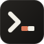
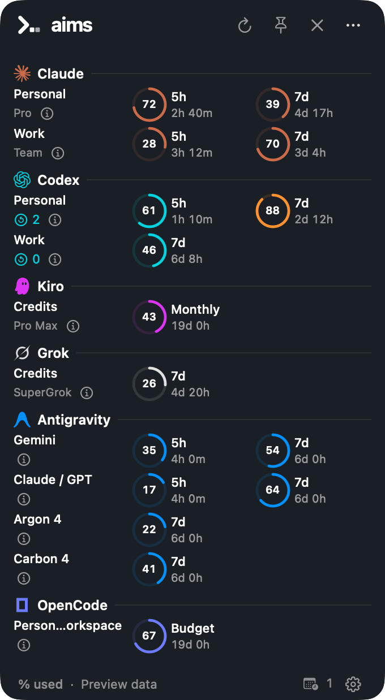
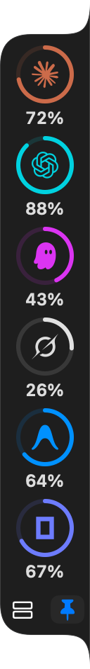

<p align="center">
  
</p>

<h1 align="center">aims</h1>

<p align="center">
  Personal and work accounts, without repeated logins.<br>
  Claude Code and Codex in your terminal. AI usage in your macOS menu bar and Edge Dock.
</p>

<p align="center">
  <a href="https://aims.doguyilmaz.com">Docs</a> ·
  <a href="https://aims.doguyilmaz.com/installation">Install</a> ·
  <a href="https://aims.doguyilmaz.com/macos-usage">macOS app</a>
</p>

<p align="center">
  
  &nbsp;&nbsp;&nbsp;
  
</p>

<p align="center"><sub>Illustrative preview data. The macOS app is currently a source preview.</sub></p>

- **Keep accounts separate.** Each account has its own login. Share history and settings, or keep them private.
- **Keep sessions moving.** Supervised Claude/Codex sessions can continue on another account at a limit and return when the preferred account recovers.
- **See your limits.** Claude, Codex, Kiro, Grok, Antigravity model groups and OpenCode budgets, with reported reset times and banked resets.

## Get started

On macOS:

```sh
brew install --cask doguyilmaz/tap/aims
aims init
claude                     # or codex
```

The setup connects your accounts and offers shell integration. Without it, use `aims claude` or `aims codex`.

[Linux, Windows, npm and Go installation →](https://aims.doguyilmaz.com/installation)

```sh
aims                       # interactive dashboard
aims usage                 # quotas and resets
aims claude@work           # pin one session to work
aims doctor --check        # inspect setup and recovery needs
```

## Aims Usage for macOS

One app: a menu-bar overview and an optional Edge Dock. Choose Compact or Gauges; place the Dock on either edge of your chosen display. Pick the account, allowance and Used/Remaining percentage for each indicator.

**Source preview:** signed public downloads, the separate Homebrew app cask and automatic updates are not active yet. The app includes a CLI and reads your existing accounts; display choices do not switch CLI logins.

[Build and set up the app →](https://aims.doguyilmaz.com/macos-usage)

## Go further

[Quick start](https://aims.doguyilmaz.com/quick-start) ·
[Sharing](https://aims.doguyilmaz.com/sharing) ·
[Editors and SDKs](https://aims.doguyilmaz.com/other-apps) ·
[Recovery](https://aims.doguyilmaz.com/troubleshooting) ·
[Commands](https://aims.doguyilmaz.com/commands)

For contributors: [how it works](https://aims.doguyilmaz.com/how-it-works), [macOS development](macos/AimsUsage/README.md) and [release preparation](docs/macos-release.md).

## Fair use and license

aims means **AI multi-session**. It runs your own accounts through the official tools; it does not pool or resell access. Keep each account within its provider’s terms. Unaffiliated with the providers. [MIT](LICENSE).
