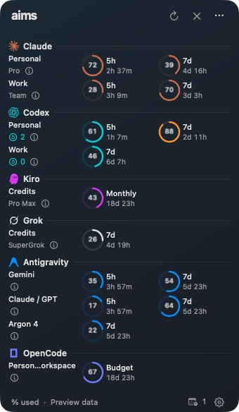

# Aims Usage for macOS

A native macOS menu bar app with an Edge Dock and an overview you can pin beside it. It uses the screen's visible frame, so it stays clear of a Dock on the bottom or either side. It runs as an accessory app with one icon and no Dock tile.

**Source preview.** Public signed app downloads, the `aims-usage` Homebrew cask and the production Sparkle channel have not been activated. The development defaults are version `0.3.0`, build `2`. The existing `aims` cask installs the CLI and its keepalive wrapper; this companion app is packaged separately.



The app reads `aims usage --json` and refreshes with `aims usage --refresh`. The interface receives a credential-free snapshot. Its bundled aims executable uses the existing aims configuration and native logins to read quotas through provider CLIs and first-party usage APIs. Native tools own authentication and renewal; the Claude usage reader uses only existing access without renewing it. Display choices do not switch active CLI accounts, reconcile sharing, start a model turn, redeem resets or buy credits. Credentials are not copied between profiles.

## Build and open

Requires macOS 14.0.0+, Swift 6.2.0+ and the Go version declared in the repository's `go.mod`.

```sh
scripts/build-macos-app.sh
open 'dist/Aims Usage.app'
```

The script builds for the Mac it runs on, bundles the matching aims CLI, uses the existing aims logo as one app icon, and applies an ad hoc signature. It does not install a login item or replace an installed app. Install the signed local bundle with `"dist/Aims Usage.app/Contents/Resources/aims" app install --from "dist/Aims Usage.app"`; the installer copies it to `~/Applications`, preserving existing app/CLI installations. Distribution signing/notarization is a separate release step; the local build is a development artifact.

Use the CLI to set up/manage Claude and Codex profiles and the provider CLIs to authenticate other providers. Then open the app and select an existing custom `AIMS_HOME` in Settings when needed. Direct-download installs can add the bundled terminal command from More → Terminal command… or Settings → Terminal command. The command uses `~/.local/bin` when no CLI exists and keeps shell files unchanged; that folder must be on the shell PATH. Homebrew app installs depend on the standalone CLI cask; CLI-initiated installs retain an existing CLI installer. The menu, optional Edge Dock and pinned overview are all part of this single app.

Set `AIMS_USAGE_CLI_BINARY` to a prebuilt, executable aims CLI if the matching Go toolchain is unavailable locally. It must target this Mac and support the usage JSON schema. `AIMS_USAGE_VERSION` defaults to `0.3.0`; `AIMS_USAGE_BUILD_NUMBER` is a separate positive integer (default `2`); `AIMS_CLI_VERSION` defaults to `0.4.7-dev`. The builder does not download a Go toolchain automatically. Temporary compilation products are removed on exit.

```sh
swift test --package-path macos/AimsUsage
AIMS_USAGE_PREVIEW=1 scripts/build-macos-app.sh
open 'dist/Aims Usage Preview.app'
```

Preview uses bundled test data, a separate preferences domain and no provider calls. It opens the side panel automatically. `AIMS_USAGE_FIXTURE=/absolute/path/snapshot.json` can also supply a local fixture for development. Preview data is visibly labeled.

The development preview's More menu opens native menu-content and small-screen overflow test windows, and can switch the preview app between light and dark appearance. Those controls and windows are compiled only for preview builds. They do not change the Mac's system appearance.

## Daily use

- **Edge Dock** is enabled by default. Settings → Edge Dock offers **Left/Right**, **Standard/Mini**, **Vertical position** and **Automatically hide**, saved independently of the dashboard style. Move the position slider between **Top** and **Bottom**, or choose **Center**. It adapts to screen/rail size without leaving the usable edge. Standard is a 64-point rail; Mini is 44 points wide with shorter rows and the same providers/readings. Provider hover details follow this choice: Standard uses a 400-point card, while Mini uses a 300-point card with tighter spacing and rows, retaining every account, window, reset and action. A blocked quota uses `!` in Mini, with its full state in the tooltip and details. The curved attachment mirrors with the selected edge; provider details open toward the screen interior. The menu popover stays at its menu-bar icon, and the pinned overview stays at the upper right independently of all Dock preferences.
- Automatic hiding is on by default. A thin edge marker remains in the Dock's region; hover there to reveal it. Leaving the Dock and its details hides it again. Moving across the gap into a detail card keeps it open; pinning keeps the Dock and card visible until you unpin or close them. Uncheck **Automatically hide** for an always-visible rail. Disabling Edge Dock in More/Settings also removes the marker. These controls do not change account or usage data.
- Provider marks show the highest current usage within the selected Dock accounts and window. Older readings retain their last known percentage with a clock badge and muted ring; missing percentages stay unknown, and passed resets are excluded. Right-click a provider to choose its usage window independently, or choose **Used/Remaining** for the whole Dock. The footer pin keeps the rail visible independently of pinning a provider detail card. Hover a provider to peek at every account/model group; click to pin and interact with that detail. Use its pin to unpin, or ×/Escape to dismiss. The grid button opens the full overview. Right-click and Control-click open a separate 260-point options panel toward the screen interior. Account chips keep it open for comparisons; a window, percentage mode or action closes it. Escape, its close button or another window also dismisses it. The rail itself does not become key for pointer-only actions; the options panel accepts keyboard input. Keyboard navigation remains available. Hiding uses short fades, with reduced-motion and keyboard actions handled without the transition. Pointer monitoring is limited to mouse movement; keyboard input is not monitored and events are not suppressed.
- Claude and Codex hover details include a small **Dock: All / Personal / Work** row when multiple accounts are reported, using your configured account names. The same choices appear in provider and overview Dock options. Each provider remembers its selected account independently across relaunches; **All** is the default. The selected account composes with the usage-window and Used/Remaining preferences. Details and the overview retain all accounts, and the menu-bar percentage is unchanged. A removed selected account stays **Missing** with an unknown Dock value until you select another account or All. These controls only filter the Dock display; they never switch aims profiles or provider logins.
- Choose **Compact** (the default) or **Gauges** in Settings → Display → Usage appearance. The menu toolbar stays focused on refresh, pin and More. Compact uses a 400-point surface with aligned provider rows. Gauges uses the same 340-point layout in the menu and pinned overview: one heading per provider, short account/model rows, small rings and adjacent reset countdowns for **every reported limit window**. Additional windows wrap within their account. Both layouts measure their content and scroll only when the available screen height is exceeded. Percentages mean **used**; the app follows the Mac's light/dark appearance. Edge Dock appearance is independent of this choice.
- No window is hidden behind a selected allowance. The account's info or banked-reset button opens its full reading, plan, observation time, error and reported banked-reset inventory, with counts and expiries kept separate for each account. Passed resets and missing values never become locally refilled or zero-percent quotas.
- **Use slim scrollbars** in Settings → Display selects small native overlay indicators, including Settings, its path editor and reminder sheets. Turn it off to follow the Mac's scrollbar style and persistent-visibility preference (the default for new installations). The app never changes the Mac's global setting. Mouse-wheel, trackpad and keyboard scrolling remain native.

- Provider hover details include Refresh and the age of the oldest displayed reading. Local usage cache changes are reread every minute without contacting providers; enabled provider refresh still runs every five minutes. Cache-only reads retain a failed provider refresh indicator, and refreshes never overlap.
- Click the aims mark in the menu bar. The optional percentage is the highest **current, successfully read** usage among visible providers; stale windows and past reset times do not contribute. It reevaluates each minute, even with automatic provider refresh disabled, and hides after a failed snapshot read. This only updates the display and does not contact a provider.
- The Edge Dock opens on first launch; its overview button opens the panel. Click the menu's pin to show it on the screen containing the pointer, or the panel's × to close it. The borderless panel has no title-bar spacer and keeps an upper-right anchor independent of the Edge Dock. It stays visible across Spaces and remembers whether it was open, including when you quit and relaunch. Closing the panel explicitly keeps it closed on the next launch and leaves the menu bar app running. Quit stops its in-flight refresh before exiting.
- Refresh asks Claude, Codex and installed meters without a model prompt. Automatic refresh runs every five minutes while enabled, including when the menu is closed. It is independent of aims keepalive and updates observation caches without clearing manual routing/login marks.
- Claude reads its exact profile's existing OAuth access token through aims and makes a bounded, read-only request to Anthropic's usage API. The app never receives credentials. Redirects, token renewal and credential writes are refused; there is no model-probe fallback. Expired or rejected access retains the original measurement time with guidance to use that account in Claude Code and retry. Token overrides are not silently replaced by another login. Native status-line reports continue to update the cache. `aims usage claude --live` remains an explicit paid model-access probe; the app does not run it.
- Reset times use the Mac's local time zone. Hover for the full date. **Not reported** means the provider omitted the reset time; its tooltip explains this separately from any known usage percentage. Past periods show an em dash with **Reset passed** until a new measurement arrives; the tooltip retains the previous period's percentage. The app never assumes that a passed reset means zero usage.
- Banked reset inventories are separate from normal quota windows. A known zero and unavailable information have different displays. Counts can be known while expiry details are not reported; detail lists can be shorter than the available count. The app only reads them.
- More → Add custom reset reminder creates a personal reminder. It does not assert that a provider has reset its quota. Reminders are shared with the CLI through `AIMS_HOME/usage-reminders.json`.
- Settings controls automatic refresh, the menu percentage and an optional explicit aims executable. The bundled CLI is the default. For a custom `AIMS_HOME`, select that existing data folder in Settings; Finder does not load shell exports. An `AIMS_HOME` inherited on the first launch is remembered. The selected path stays in Settings, and changing it never moves files. Apply is disabled during a refresh; applying then clears the display and reads the newly selected cache.
- Finder launches search the usual provider, Go, Cargo, npm, Bun and Homebrew directories. Add other absolute CLI folders in Settings (one per line). Custom folders take precedence; no shell startup files are executed.

Provider order is Claude (each configured account), Codex (each account), Kiro, Grok, Antigravity (each reported model group), then OpenCode. All Antigravity group IDs and bucket IDs are retained; Gemini, Claude/GPT, Argon and Carbon are displayed separately **when reported by that account's CLI**. An unreported model group is not fabricated. OpenCode shows Go windows, zero-dollar blocking budgets, and separate per-model budgets when returned.

Errors retain the previous reading with its age; they do not turn old percentages into fresh data. Missing quotas and reset inventories stay unknown. A capped reset-detail list is labeled incomplete, and explicit non-expiring credits differ from unknown expiry. The app stores preferences and selected paths only. Removing it leaves aims, its caches, custom reminders, credentials, sessions, history and other integrations intact.

See the [provider support and sources](../../docs/content/macos-usage.md) for API limitations.

The app version and source revision appear in More and Settings so a running older build can be identified. `AIMS_USAGE_SOURCE_REVISION` can override the development revision label; the builder records the Git revision and a dirty marker for tracked changes or untracked files by default. Ignored build outputs do not mark it dirty; an unreadable Git status is labeled unknown. These are build identifiers, separate from the SemVer app version and integer build number.

Provider marks are the pinned Lobe Icons 1.102.0 SVG assets (MIT); the source metadata and license are bundled from [packaging/provider-marks](../../packaging/provider-marks). The app still ships one application icon. No icon package is downloaded at runtime.

Application controls use shared monochrome SF Symbols and matching hover/press feedback. Pinned controls use the system accent color and filled pin; overview uses stacked rows and banked resets use a reset arrow. The menu-bar symbol uses the inner aims terminal mark with a subtly split cursor. Pointer actions leave controls unfocused while Tab retains visible keyboard focus; Escape closes the floating panel. Provider marks and the application icon are independent of these control symbols.

## App updates

Sparkle 2.10.1 is pinned in `Package.resolved` and embedded in the app bundle. Its complete upstream license/third-party notices and pinned source metadata are bundled in `Contents/Resources/sparkle`. Development and fixture preview builds have no update feed and never start the updater. A release with a complete HTTPS feed/public-key configuration enables **Check for Updates…** in More and Settings → App updates. Automatic checking is opt-in; automatic installation and system profiling default to off. Sparkle owns update validation, installation and relaunch. The app, Edge Dock and bundled aims are updated as one bundle; a separately selected aims executable and provider CLIs remain managed by their own installers.

The release builder makes a universal Apple Silicon/Intel app, signs nested Sparkle helpers and aims before signing the app, notarizes/staples it, then signs the final archive and generates an appcast and a separate `aims-usage` Homebrew cask. The cask hashes that final archive and leaves the standalone CLI and profile data alone. Preparation supports an existing Keychain profile, a notarization API key, or Apple ID/app-specific-password inputs; it does not publish anything. The existing native-app examples, setup inputs and later activation smoke test are documented in [macOS release operations](../../docs/macos-release.md). The current development build does not become update-enabled merely because Sparkle is linked.
